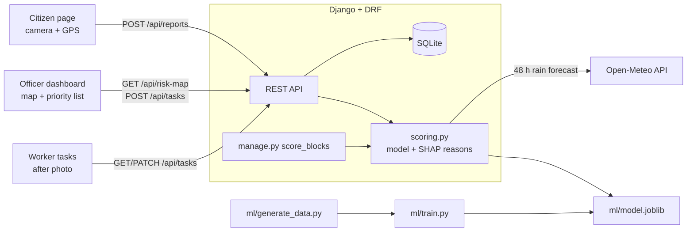

# WasteWatch

Predictive sanitation for Indian city wards. Citizens report garbage with a photo and GPS, a model predicts which
100 m blocks will become garbage hotspots in the next 48 hours, ward officers assign teams from a priority map, and
workers upload an "after" photo to mark a block cleared.

100% free and open-source: no paid APIs, no API keys.

## Architecture



| Folder | What it is |
| --- | --- |
| `frontend/` | React + Vite, React Router, Leaflet + OpenStreetMap tiles |
| `backend/` | Django + Django REST Framework, SQLite, token auth, django-cors-headers |
| `ml/` | Ward definition, shared features, synthetic data generator, Gradient Boosting model, SHAP explanations |

## Setup (Windows)

Needs **Python 3.11+**, **Node.js 18+** and **Git**.

```bat
:: 1. Python environment (from the repo root)
python -m venv .venv
.venv\Scripts\activate
pip install -r requirements.txt

:: 2. Train the model
python -m ml.generate_data
python -m ml.train

:: 3. Database, sample ward and first forecast
cd backend
python manage.py migrate
python manage.py seed_ward
python manage.py score_blocks
python manage.py runserver
```

In a second terminal:

```bat
cd frontend
npm install
npm run dev
```

Open http://localhost:5173. On macOS/Linux use `source .venv/bin/activate` instead of `.venv\Scripts\activate`.

**Demo logins** (password `demo1234`): `officer1`, `worker1` (Team A), `worker2` (Team B). Citizens can report
without logging in.

Run `python manage.py score_blocks` once a day (e.g. with Windows Task Scheduler) to refresh the forecast. The risk
map also scores automatically if today's scores are missing.

## API

| Method | Endpoint | Who | Purpose |
| --- | --- | --- | --- |
| POST | `/api/auth/login` | anyone | Returns a token and role |
| POST | `/api/reports` | anyone | Multipart: `photo`, `lat`, `lng`, `size`, `type` |
| GET | `/api/risk-map` | anyone | Block risk, reasons, open tasks. Add `?rain=1&market_day=1&missed_pickup=1` for a live what-if |
| GET | `/api/tasks` | officer / worker | All tasks (officer) or the worker's team tasks |
| POST | `/api/tasks` | officer | JSON: `block` (e.g. `D4`), `team` |
| PATCH | `/api/tasks/<id>` | officer / team worker | Multipart: `status`, `after_photo`. `cleared` needs an after photo |

Send the token as `Authorization: Token <token>`.

## How the prediction works

Features per block (`ml/features.py`, shared by training and scoring so they can't drift apart): reports since last
pickup, days since last pickup, foot traffic, nearness to the market / bus stand / construction site / open plot,
whether the weekly market falls in the next 48 h, and forecast rain from Open-Meteo.

A `GradientBoostingClassifier` predicts the probability of a hotspot in the next 48 h. SHAP (`TreeExplainer`) turns
each prediction into the block's top three reasons in plain words, e.g. "Open plot (illegal dumping)". Training uses a
time-based split (last 60 days held out), so the reported ROC-AUC is not inflated by leakage.

Clearing a block resets its "last pickup" time and rescores it immediately.

## Sample data note

All data is **synthetic**. The ward is a 10 × 7 grid of 100 m blocks placed over Bhavnagar, Gujarat, with a
vegetable market, bus stand, construction site and open plot. `ml/generate_data.py` simulates a year of pickups,
citizen reports, rain and a weekly Sunday market, and labels hotspots from a hidden rule plus noise. The model's score
on this data says nothing about real-world accuracy; it needs real ward data before any real use.

The photo classifier (`backend/core/photo_ai.py`) is a stub that accepts every photo. On phones, the camera and GPS
need HTTPS (localhost on a computer is fine).

## License

MIT, see [LICENSE](LICENSE).
